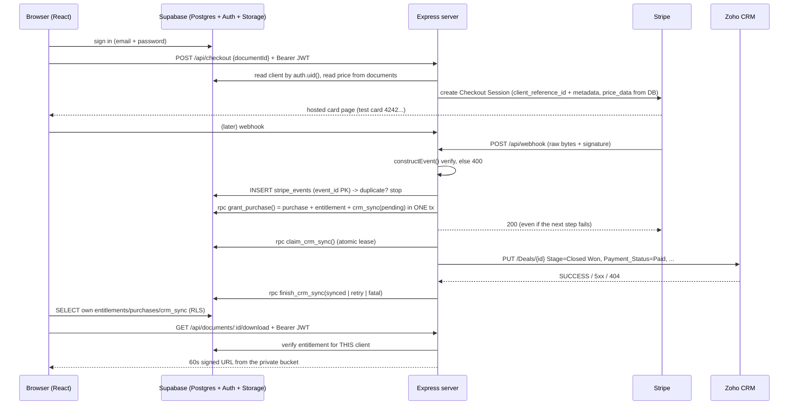

# Paid Client Access

Stripe test Checkout → Supabase entitlement → Zoho CRM Deal marked paid, with a
two-client portal that proves tenant isolation.

A client buys access to a sample document. The payment is verified by signature,
matched to the client by stable IDs, and turns into an entitlement in Postgres.
The matching Zoho Deal is then updated; if Zoho is unreachable the client still
gets access and the sync is queued for retry. The browser reads its own status
straight from Supabase under Row Level Security.

---

## 1. Status at a glance — be precise about this in the interview

| Verified on this machine | How |
| --- | --- |
| Webhook signature acceptance/rejection | `server/test/webhookSignature.test.ts` (6 tests, real Stripe SDK signing locally) |
| Idempotency: duplicate, concurrent, cross-event replays | `server/test/webhookIdempotency.test.ts` (7 tests) |
| Zoho outage keeps access granted, row pending, retry works | `server/test/zohoOutage.test.ts` (16 tests) |
| Checkout guards, download authorization, admin key | `server/test/accessIsolation.test.ts` (11 tests) |
| TypeScript compiles across both workspaces | `npm run typecheck` |
| Portal bundle builds | `npm run build -w web` |
| Server boots and every guard answers correctly | manual probe: `/api/health` 200, unsigned webhook 400, no-token checkout 401, bad admin key 401 |
| The **production** start path | `npm run build` then `NODE_ENV=production node server/dist/index.js` on a throwaway dummy env: health 200 and the same three guard answers; the compiled output imports only the six runtime packages, so `npm ci --omit=dev` boots it |
| Perf claims that are numbers, not opinions | `vite build` output gzip-measured before/after the chunk split, and the Stripe/Node defaults read out of the installed `stripe@17.7.0` and `https.globalAgent` (section 5C). The compiled server was booted again afterwards on a spare port |

| Needs your credentials before it can be claimed | Why |
| --- | --- |
| The six SQL migrations actually running | No Postgres/Docker on this machine. Apply them (section 4C) before the demo and report any error. |
| A real Stripe redirect | Requires `sk_test_...` |
| A real Zoho Deal turning to Closed Won | Requires the OAuth refresh token |
| RLS isolation against a live project | `RUN_INTEGRATION=1 npm run test:integration -w server` — it is skipped, not deleted, when credentials are absent |
| Clicking through the portal in a browser | Requires Supabase + Stripe |
| Observing the SIGTERM drain | Windows cannot deliver `SIGTERM` to a Node process; the handler is registered and the shutdown path is exercised on the deploy host (section 5B, point 4) |

The offline tests run against an in-memory repository that mirrors the unique
constraints and the lease logic of the SQL, which is why they are meaningful
without a database. They are not a substitute for running the migrations.

---

## 2. Architecture



Three rules the whole design rests on:

1. **The browser never decides anything about money or access.** It reads rows
   that RLS hands it, and it asks the server for a download URL. Stripe and
   Zoho secrets exist only in `server/`.
2. **Access is granted by Postgres, not by Zoho.** The entitlement and the CRM
   outbox row are written in one transaction; the CRM call happens afterwards
   and may fail without taking the customer's access down with it.
3. **Every step is idempotent**, so a replayed webhook is a no-op rather than a
   second purchase.

---

## 3. Folder structure

```
.
├─ README.md                  ← setup, security, interview crib
├─ WALKTHROUGH.md             ← the 15-minute demo script
├─ TRADEOFFS.md               ← what works, what does not, what is next
├─ .env.example               ← every server-side variable, documented
├─ supabase/
│  ├─ migrations/0001_schema.sql            six tables
│  ├─ migrations/0002_rls.sql               policies + documents_public view
│  ├─ migrations/0003_grant_purchase.sql    the one-transaction grant
│  ├─ migrations/0004_crm_sync.sql          claim / finish / list-due
│  ├─ migrations/0005_revoke_access.sql     refund path
│  ├─ migrations/0006_performance.sql       indexes + ANALYZE (section 5C)
│  └─ seed.sql                              SQL alternative to npm run seed
├─ server/
│  ├─ src/env.ts                            zod-validated env, fail fast
│  ├─ src/app.ts                            CORS, raw-before-JSON, routers
│  ├─ src/runtime.ts                        wires the real collaborators
│  ├─ src/routes/{webhook,checkout,download,admin}.ts
│  ├─ src/stripe/{checkout,webhookHandler}.ts
│  ├─ src/zoho/{oauth,deals}.ts
│  ├─ src/crm/syncPurchase.ts               the only Zoho caller
│  ├─ src/db/{repository,supabaseRepository}.ts
│  ├─ src/lib/{supabaseAdmin,supabaseAuth}.ts
│  ├─ src/middleware/{requireUser,rateLimit}.ts
│  ├─ src/scripts/{seed,retryCrmSync,zohoBootstrap}.ts
│  ├─ tsconfig.json                         strict, noEmit (typecheck + tests)
│  ├─ tsconfig.build.json                   emits dist/ for `npm start`
│  └─ test/                                 40 offline tests + 1 live RLS test
└─ web/
   ├─ src/{App,Login,Portal}.tsx            two screens
   ├─ src/{supabaseClient,api}.ts           anon key + Bearer calls only
   └─ .env.example                          VITE_ variables only
```

---

## 4. Manual steps in the three dashboards

Do these yourself; nothing here needs the code.

### 4A. Zoho CRM Developer Edition

1. Sign up for the Developer Edition and create a CRM org.
2. **Create four custom fields on Deals** (Setup → Customize → Fields and Layouts
   → Deals → Fields). The API Name must be exactly this — the code writes these
   names in `server/src/zoho/deals.ts`:

   | Field label | API Name | Data type |
   | --- | --- | --- |
   | Payment Status | `Payment_Status` | Text (single line) |
   | Stripe Payment ID | `Stripe_Payment_ID` | Text (single line) |
   | Paid Amount | `Paid_Amount` | Decimal (2 places) |
   | Paid At | `Paid_At` | Date/Time |

3. Note the **Stage** picklist value that means paid in your org. The default
   here is `Closed Won`; if yours differs, put that value in `ZOHO_PAID_STAGE`.
4. Create two Contacts (`client-a@example.com`, `client-b@example.com`) and one
   open Deal per contact. **Copy both Deal IDs** — they go into `.env` as
   `ZOHO_DEAL_ID_CLIENT_A` / `ZOHO_DEAL_ID_CLIENT_B`. The `clients` table also
   has a `zoho_contact_id` column because the brief specifies it; this build
   matches on Deal id only, so the seeder leaves it NULL rather than storing a
   value nothing reads.
5. Create the OAuth client: Setup → Developer Hub → API → **Server-based web
   application** (self client). Redirect URI: `http://localhost:8790/zoho/callback`.
   Scopes: `ZohoCRM.modules.deals.ALL, ZohoCRM.users.READ`. Copy the Client ID
   and Secret.
6. Generate the refresh token with `npm run zoho:bootstrap` (section 5). It
   prints the line to paste into `.env`.

### 4B. Stripe (test mode)

1. Dashboard → switch to **Test mode**. Copy the secret key `sk_test_...`.
2. Install the CLI and authenticate: `stripe login`.
   Windows: `winget install --id Stripe.StripeCli -e` (open a **new** terminal
   afterwards — the installer changes `PATH`). macOS:
   `brew install stripe/stripe-cli/stripe`. Either way the binary comes from
   `github.com/stripe/stripe-cli/releases`. Verify with `stripe --version`.
   It is not an npm package, so `npm install` does not provide it.
3. Do **not** create a Dashboard webhook endpoint for local work. `stripe listen`
   prints a `whsec_...` secret for your `.env`; a Dashboard endpoint secret will
   not verify local deliveries.
4. No Product/Price is required: the session is built with `price_data` taken
   from the `documents` row. If you prefer a catalogued price, set
   `STRIPE_PRICE_ID` and it is used instead.

### 4C. Supabase

1. Create a project. Copy the Project URL, `anon` key and `service_role` key.
2. Authentication → Providers → Email: **disable "Confirm email"** (the seed
   creates users directly, but this keeps magic-link/manual signups painless).
3. Apply the migrations, either way:
   - CLI: `supabase link --project-ref <ref>` then `supabase db push`
   - SQL editor: run the five files in `supabase/migrations/` in numeric order.
   The SQL editor route needs nothing installed, so a missing Supabase CLI is
   not a blocker — paste each file top to bottom, 0001 through 0006.
4. Storage → New bucket → **`client-documents`**, private. Upload any PDF at the
   key `sample-document.pdf`.
5. Seed: `npm run seed` (creates the two auth users, the two client rows and the
   document row). The SQL-only alternative is `supabase/seed.sql`, which cannot
   create auth users — it leaves you the two UPDATE statements to paste.

---

## 5. Running it — local and production

### 5A. Local

Needs Node 20+ (`engines` in the root `package.json`) and the Stripe CLI from
4B.2. Everything else is npm: one `npm install` at the root populates both
workspaces and hoists `tsx`, `vitest`, `typescript` and `vite` into
`node_modules/.bin`.

```bash
git init && npm install              # workspaces: server + web
cp .env.example .env                 # then fill in the values from section 4
cp web/.env.example web/.env.local   # two public VITE_ values + API base url

npm run zoho:bootstrap               # one time: prints ZOHO_REFRESH_TOKEN=...
npm run seed                         # two demo logins + the sample document

npm run dev                          # server on :8787, portal on :5173
npm run stripe:listen                # in a separate terminal; note the whsec_
```

Test logins after seeding: `client-a@example.com` and `client-b@example.com`,
both with the password in `SEED_CLIENT_PASSWORD`.

| Command | What it does |
| --- | --- |
| `npm test` | 40 offline tests, no credentials needed |
| `RUN_INTEGRATION=1 npm run test:integration -w server` | live RLS isolation proof |
| `npm run retry-crm-sync` | re-attempt every open CRM sync |
| `npm run retry-crm-sync -- --purchase <id>` | re-attempt one purchase |
| `npm run retry-crm-sync -- --list` | show what is owed, call nothing |
| `npm run typecheck` | both workspaces |

### 5B. Production

The server runs **compiled**, so a production host needs no dev tooling:

```bash
npm run build        # server/dist (plain ESM) + web/dist (static bundle)
npm ci --omit=dev    # runtime install: dependencies only, no typescript/vitest
npm start            # node server/dist/index.js
```

`server/dist/**/*.js` imports exactly six packages — `express`, `cors`,
`dotenv`, `stripe`, `zod`, `@supabase/supabase-js` — and nothing from
`devDependencies`. That is what makes `--omit=dev` safe rather than hopeful, and
it is checkable in one command:
`grep -rhoE "from '[^.n][^']*'" server/dist --include=*.js | sort -u`.

On the host:

1. **No `.env` file.** Set the same variable names in the platform's secret
   store; dotenv finds no file and the process reads the injected environment.
   `loadEnv` still fails fast on a missing variable and prints names only.
2. **`TRUST_PROXY=1`** behind the platform's single reverse proxy. Left at 0,
   `req.ip` is the proxy's address, so the per-IP rate limit would count every
   visitor as one client. Keep it 0 when the process is exposed directly —
   trusting `X-Forwarded-For` you do not need to trust is a spoofing hole.
3. **Health check** `GET /api/health` returns `{"ok":true,...}` with no database
   round-trip. Deliberate: a Supabase or Zoho outage should not make the platform
   restart a process that is still able to serve and to receive webhooks.
4. **Graceful drain.** `SIGTERM`/`SIGINT` stop the listener, close idle
   keep-alive sockets, let in-flight requests finish, and force-exit after 10s.
   Not observable on Windows — it cannot deliver `SIGTERM` to a Node process —
   so check it on the deploy target with `kill -TERM <pid>` and look for
   `shutdown started` then `shutdown complete` in the log.
5. **Portal** is served statically from `web/dist`; `VITE_API_BASE_URL` must
   point at the server origin, and that origin must match the server's
   `APP_BASE_URL` (CORS and the Stripe success URL are both built from it).
   Vite inlines `VITE_*` at **build** time, so rebuild after changing them.
6. **Stripe**: register the live-test webhook endpoint as
   `https://<host>/api/webhook` and use the **dashboard** secret, not the
   `stripe listen` one. This is the single most common cause of
   `400 invalid_signature` in production.
7. **One instance.** The rate limiter and the Zoho token cache are per-process,
   so two instances double the limits and refresh tokens independently. Scaling
   past one needs Redis first (see `TRADEOFFS.md`).
8. **Migrations are out of band** (`supabase db push` or the SQL editor), never
   at boot — a container restart must not attempt DDL.

Cron/CLI work on a host without devDependencies uses the compiled scripts:
`node server/dist/scripts/retryCrmSync.js --list` (same flags as the npm
wrapper). A scheduled call to that command, or to
`POST /api/admin/retry-crm-sync`, is the missing sweeper described in
`TRADEOFFS.md`.

---

### 5C. Performance work

Asked for after the brief's requirements were met. Every number below is
measured on this machine; where a claim could not be measured, it says so.

**Portal round trips (`web/src/Portal.tsx`).** The worst defect was not in SQL.
`refresh` had `snapshot` in its `useCallback` deps and called `setSnapshot`, so
every render minted a new `refresh`, the mount effect re-ran, and the portal
re-queried all four tables forever — an unbounded request loop that only a live
Supabase project would have shown, and this one has no credentials yet. It now
keeps the latest rows in a ref, so `refresh` is created once. Three more changes
in the same file: the four first-load queries still run with `Promise.all` (one
round trip, not four), the per-card `.find()` scans are replaced by three
`useMemo` Maps, and the post-payment poll asks for `entitlements` alone instead
of all four tables — the wait went from 120 queries to at most 30 plus one full
refresh at the end. Not clicked through: needs Supabase credentials.

**Indexes (`supabase/migrations/0006_performance.sql`).** One genuine gap: the
refund path joins `entitlements.purchase_id` to `purchases`, and that column had
no index at all, so revoking access read every entitlement row (it is also the
column `ON DELETE CASCADE` has to probe). The sweeper's old
`(status, last_attempt_at)` composite indexed already-synced rows forever and
matched neither branch of its `OR`, so it became two partial indexes with
explicit `asc nulls first`, which is the ordering `list_crm_sync_due()` asks
for. Plus `ANALYZE` on the three tables the webhooks write. **No `EXPLAIN`
numbers exist for any of this** — there is no Postgres on this machine, and at
demo row counts every index is invisible anyway. They are attributed to a named
query so a reviewer can check the reasoning instead of trusting a benchmark.

**Bundle (`web/vite.config.ts`).** `build.target: 'es2022'` and a manual split
into `react` / `supabase` / app chunks, then rebuilt and measured (JavaScript
only, CSS is 2,109 B / 853 B gzip and untouched):

| | raw | gzip |
| --- | ---: | ---: |
| before — one `index.js` | 377,585 B | 107,083 B |
| after — `supabase` 223,762 + `react` 140,855 + app 9,910 | 374,527 B | 107,764 B |

So `es2022` (not measured separately from the split) took ~3 kB off the raw
bytes, and the split *added* 0.7 kB gzip to the first load because three files
compress independently. What it buys is the redeploy case: editing portal code
now re-downloads 4 kB of app chunk instead of 107 kB, because the two vendor
hashes do not move. `web/src/supabaseClient.ts` also injects `preconnect` links
for the Supabase and API origins, which are only known from env at runtime so
they cannot be static tags in `index.html`.

The one large lever left is named rather than pulled: `@supabase/supabase-js`
is 58 kB of the 108 kB gzip and its bundle carries realtime/socket code the
portal never subscribes to. Reaching the same rows with plain `fetch` against
PostgREST would drop most of it — and would also mean hand-rolling JWT refresh
for a brief that says the browser must read Supabase directly. Bad trade, so it
stays.

**Stripe calls (`server/src/runtime.ts`).** Checked against the installed
`stripe@17.7.0` source rather than from memory: its default `timeout` is 80,000
ms with 2 retries, so a hung connection could sit on a checkout request for four
minutes. Now `timeout: 15_000, maxNetworkRetries: 2`. No custom `httpAgent` was
added — `require('https').globalAgent` on this Node (v24.19.0) already reports
`keepAlive: true`, and supplying an agent only moves the SDK onto its
raw-socket client. Retried POSTs are safe: the SDK stamps a
`stripe-node-retry-*` `Idempotency-Key` on every POST when retries are enabled,
so a retry re-delivers the same Checkout Session instead of creating a second
one.

---

## 6. Testing webhooks (including idempotency)


```bash
npm run stripe:listen
# prints: webhook secret for local connections: whsec_xxxxx

stripe trigger checkout.session.completed
```

In the Supabase SQL editor, watch the four rows the payment creates:

```sql
select event_id, type, status from stripe_events order by received_at desc limit 5;
select id, stripe_session_id, amount_cents, paid_at from purchases order by paid_at desc limit 3;
select client_id, document_id, granted_at, revoked_at from entitlements;
select purchase_id, zoho_deal_id, status, attempts, last_error from crm_sync;
```

**Prove idempotency** — resend the very same event:

```bash
stripe events resend evt_1ABCDEF... --events checkout.session.completed
```

Expected: HTTP 200, `{"duplicate":true}`, and **no new rows**. The second
delivery is stopped by the `stripe_events.event_id` primary key, and even if two
deliveries race past that, `purchases.stripe_session_id` and
`entitlements(client_id, document_id)` are unique, so the inserts conflict and
do nothing.

**Test card:** `4242 4242 4242 4242`, any future expiry, any CVC, any postcode.
For an async payment method (the `async_payment_succeeded` path) use a
test IBAN with `SEPA Direct Debit` and wait for the CLI to settle it.

**Force a failure to arrive:**

```bash
stripe trigger charge.refunded          # revokes the entitlement
stripe trigger checkout.session.expired # recorded, grants nothing
```

---

## 7. Security checklist

- [x] `.gitignore` covers `.env`, `web/.env.local`; only `.env.example` is committed.
- [x] `SUPABASE_SERVICE_ROLE_KEY`, `STRIPE_SECRET_KEY`, `STRIPE_WEBHOOK_SECRET`
      and every Zoho credential are read only in `server/`. The browser gets
      `VITE_SUPABASE_URL`, `VITE_SUPABASE_ANON_KEY`, `VITE_API_BASE_URL` — all
      public by design.
- [x] Webhook signature verified against the **raw body**: the webhook router is
      registered before `express.json()` in `server/src/app.ts`, otherwise the
      bytes are gone and every check fails.
- [x] Charged amount comes from the `documents` table. The request body carries
      only a document id; a body containing `amountCents: 1` is ignored (tested).
- [x] Every input validated with zod: document id must be a UUID, event metadata
      must be UUIDs, purchase id on the admin route must be a UUID.
- [x] Client identity comes from the bearer token (`auth.uid()` → `clients`
      row), never from a client-supplied `client_id`.
- [x] RLS enabled on all six tables; `documents` and `stripe_events` are not
      readable from the browser at all — the portal reads the
      `documents_public` view, which has no `storage_path` column.
- [x] No INSERT/UPDATE/DELETE policy exists for `anon`/`authenticated` on any
      table; the granting RPCs are `REVOKE ... FROM public, anon, authenticated`
      and `GRANT EXECUTE TO service_role` only.
- [x] Downloads go through the server, which checks the entitlement and mints a
      **60-second** signed URL from a private bucket. The object key never
      reaches the browser.
- [x] Rate limits on `/api/checkout` (10/min/user), `/api/documents/:id/download`
      (30/min/user) and the admin routes (20/min/IP).
- [x] CORS locked to `APP_BASE_URL`.
- [x] The logger redacts any key matching secret/token/key/password/authorization/
      email/card/cvc/pan before it is printed, and `expires_in` is logged rather
      than the token.
- [x] Admin key compared with `timingSafeEqual`.
- [x] Zoho access tokens are cached in memory only, never written to disk or logs.

---

## 8. What was built, mapped to the brief

### R1 — verified webhook, stable-ID matching

- `POST /api/webhook` uses `express.raw` and `stripe.webhooks.constructEvent`;
  a bad signature is 400 before any handler runs.
- The Checkout Session is created server-side from an authenticated request with
  `client_reference_id = clients.id` and metadata
  `{client_id, document_id, zoho_deal_id}`.
- Matching uses only those IDs — never email, never name.
- `checkout.session.completed` is honoured only when `payment_status === 'paid'`;
  `checkout.session.async_payment_succeeded` grants for delayed methods; anything
  else returns 200 and does nothing.
- A session whose metadata does not line up with the stored client, document,
  deal **or price** is logged, marked `quarantined` in `stripe_events` with the
  reason, and grants nothing. Quarantine answers 200 so Stripe stops retrying
  something that will never succeed.

### R2 — entitlement only after payment, idempotent

- Six tables exactly as specified, as SQL migrations.
- Three independent gates:
  1. `stripe_events.event_id` primary key — a replay stops immediately;
  2. `grant_purchase()` runs purchase + entitlement + `crm_sync(pending)` in one
     Postgres transaction with `ON CONFLICT DO NOTHING`;
  3. `claim_crm_sync()` moves the row out of `pending` atomically, so only one
     worker may call Zoho.
- **One deliberate refinement over the brief:** the event gate is three-way
  (`new` / `retry` / `done`) rather than "seen it before → stop". If the ledger
  row was written but the grant then failed, we return 500 so Stripe retries —
  and that retry carries the *same* event id. A naive duplicate check would
  swallow it and leave a paying customer locked out forever. Only an event that
  already reached `processed` or `quarantined` is treated as done.
- 200 is returned as soon as the transaction commits, even if Zoho fails.

### R3 — Zoho update with graceful failure and retry

- OAuth2 refresh-token flow with an in-memory cache that expires 60s early, plus
  singleflight so a burst of webhooks cannot stampede the token endpoint.
- One automatic refresh-and-retry on 401.
- `PUT {ZOHO_API_URL}/Deals/{id}` writes `Stage`, `Payment_Status`,
  `Stripe_Payment_ID`, `Paid_Amount`, `Paid_At`. Field names are in one place.
- Failure classification: 429 / 5xx / timeout / network / unknown code →
  **retryable**, row goes back to `pending` with `attempts++` and `last_error`.
  400 / 403 / 404 / `INVALID_DATA` / `MISSING_REQUIRED_FIELDS` → **fatal**, row
  becomes `failed` and stops burning attempts. Zoho answers HTTP 200 with a
  per-record `code`, so the body is inspected as well as the status.
- Retry both ways: `npm run retry-crm-sync [-- --purchase <id>|-- --list]` and
  `POST /api/admin/retry-crm-sync` guarded by `ADMIN_API_KEY`.
- Demo outage switch: `ZOHO_SIMULATE_FAILURE=true` makes every Zoho call fail as
  if the API were down, without touching your org.
- `syncPurchase` never throws: the webhook cannot be broken by the CRM, and the
  retry command gets a per-row verdict.

### R4 — portal and isolation

- Two seeded clients, each with its own Zoho Deal id; Supabase email/password.
- Portal shows title, Locked/Unlocked, purchase, and CRM sync status
  (Pending / Synced / Failed + the stored error), a Buy button and, once
  unlocked, Download.
- Status is read **directly from Supabase** with the anon key + the user JWT,
  filtered by RLS. `crm_sync` is scoped through its purchase because it has no
  `client_id` of its own.
- The success redirect never grants: it polls for up to 60 seconds.
- Download: server verifies the JWT, requires an unrevoked entitlement for that
  exact client + document pair, then returns a 60s signed URL.
- Automated isolation: `accessIsolation.test.ts` (Client B gets 403 on Client A's
  document, and the bucket is never touched) and
  `rlsIsolation.integration.test.ts` (live project: B's explicit `eq(client_id,
  A)` filter returns zero rows, `documents.storage_path` is unreadable,
  `grant_purchase` cannot be called from a user token).

### Edge cases (brief section 5) — every one, and where it lives

| Edge case | Handled | Where |
| --- | --- | --- |
| Duplicate delivery | code + test | ledger gate, `webhookIdempotency.test.ts` |
| Out-of-order delivery (async event before `completed`) | code | both call `grantFromSession`; the grant is idempotent, so order is irrelevant |
| Concurrent deliveries of one event | code + test | 5 racing deliveries → exactly one `isNewPurchase` |
| Webhook lands before the user returns from Checkout | code | success page polls; the redirect grants nothing |
| Payment real but our DB write failed | code + test | `markEvent('failed')` then **500** so Stripe retries |
| Zoho access token expired | code + test | one forced refresh, then one retry of the PUT |
| Zoho 429 / 5xx / timeout / network | code + test | retryable → row stays `pending`, `attempts++`, `last_error` |
| Zoho Deal deleted or not found (404) | code + test | fatal → row becomes `failed` and stops burning attempts |
| Metadata missing / tampered, client or document unknown, deal mismatch | code + test | quarantined with the reason, 200, no grant |
| Charged amount ≠ catalogue price | code + test | quarantined, same gate |
| Buy clicked twice / document already owned | code | `409 already_owned`, before any Stripe call |
| Async payment method settles later | code | unpaid `completed` is marked `processed` with a `deferred: …` reason and grants nothing; the async event grants |
| `checkout.session.expired` | code | recorded, grants nothing |
| Refund | code + test | `revoke_access()` sets `refunded_at` + `revoked_at` |
| Refund should also update Zoho | **documented, not built** | `TRADEOFFS.md` — needs an outbox row per refund |
| Disputes (`charge.dispute.created` / `.closed`) | **documented, not built** | safe-ignore branch today; plan in `TRADEOFFS.md` |
| Stuck `pending` rows: cron, alerting, reconciliation | **documented, not built** | `list_crm_sync_due()` + the retry command are the pieces a cron would call |

Three of these are time-and-config cases, so they are worth stating precisely:

**Clock skew between Stripe and this server.** `constructEvent` rejects a
signature whose timestamp is more than 300 seconds from the local clock — that
tolerance is the library default and is not overridden here (it is the optional
4th argument). The consequence is that a server whose clock drifts starts
failing *genuine* signatures with 400, which looks like an attack but is just
NTP. Keep the box clock synced, and if Stripe says it delivered while
`stripe_events` is empty, check the server clock before checking anything else.

**Stripe API version changes.** No `apiVersion` is pinned in
`server/src/runtime.ts`, so requests use the version the *account* defaults to
(Dashboard → Developers → Webhooks → API version). That is deliberate: one
place to change it on purpose, instead of several places changing by accident.
The risk is that a version bump renames a field this handler reads
(`amount_total`, `payment_status`, `client_reference_id`, `metadata`). Because
every one of those is validated before granting, a bad version surfaces as a
quarantined row carrying a reason rather than as a silent partial grant — so
after any bump, run `stripe trigger checkout.session.completed` locally and
confirm the grant still happens.

**Secret rotation.** Four secrets rotate independently and each fails
differently:
- `STRIPE_WEBHOOK_SECRET` (`whsec_…`) — rotating it makes every delivery 400
  until `.env` changes and the server restarts. Stripe can keep a new endpoint
  secret alongside the old, so the zero-downtime path is to verify against a
  list of candidate secrets and drop the old one after cutover; this build
  accepts exactly one, which is right for a demo and the first thing to widen.
- `SUPABASE_SERVICE_ROLE_KEY` — rotation stops the server dead (every DB call
  401s); the browser's anon key is separate, so the portal still loads and only
  writes fail. Deploy the new key before revoking the old.
- `ZOHO_CLIENT_SECRET` / refresh token — a revoked refresh token returns
  `invalid_grant`, classified **fatal** so it is not retried forever, and shows
  up in `crm_sync.last_error`. The fix is re-running `npm run zoho:bootstrap`.
- `ADMIN_API_KEY` — yours to choose (`openssl rand -hex 24`); compared with
  `timingSafeEqual`, so a correct prefix of it does not authenticate.

---

## 9. Interview crib — the questions this invites

**Why is the webhook parser before the JSON parser?**
Stripe signs the exact bytes it sent. If `express.json()` runs first, `req.body`
is an object and the raw bytes are gone, so `constructEvent` can never match.
This is a one-line ordering rule in `app.ts` and an easy thing to break later,
so there is a test whose only job is to keep it working.

**How do you know a webhook is genuine?**
`stripe.webhooks.constructEvent` recomputes the HMAC from the raw body with
`STRIPE_WEBHOOK_SECRET` and checks the timestamp is inside a 5-minute window.
Failure is 400 — before any DB work, so a flood of forged requests is cheap.

**How is a duplicate webhook made harmless?**
Three gates, in order of increasing cost: the event-id primary key, then two
unique constraints inside one transaction, then the atomic claim that guards the
Zoho call. Any one of them alone would mostly work; the point is that the
expensive external call is behind all three.

**Why return 200 when Zoho is down?**
Because 500 means "Stripe, please retry the payment notification", and the
payment notification is not the thing that failed. Returning 500 would produce a
retry storm against a CRM that is already down, and the customer would wait for
access they have already paid for. Instead the outbox row says `pending` and a
retry command drains it later.

**When *do* you return 500?**
Only when our own database write failed. The payment is real, the entitlement is
not written, and Stripe's retry is exactly the queue we want.

**How does the browser know it has access?**
It queries its own `entitlements`/`purchases`/`crm_sync` rows through Supabase
with the anon key. Postgres filters by `auth.uid()`. The server is not in that
read path at all, which is why the anon key being public is not a problem.

**What stops Client B reading Client A's data?**
RLS policies that compare `client_id` with `current_client_id()`, a
`SECURITY DEFINER` lookup of `auth.uid()`. There is no INSERT/UPDATE/DELETE
policy for a browser role anywhere, and the granting RPC is executable by
`service_role` only. Proven by the integration test.

**Why a view for documents?**
The brief wants catalogue metadata readable but `storage_path` secret. A plain
(non `security_invoker`) view runs as its owner, so I can expose
`id/title/price_cents/currency` and simply leave the path out, while revoking
all access to the base table from browser roles. The alternative — column-level
`GRANT SELECT (id, title, ...)` — is smaller but depends on how PostgREST expands
`select=*`, which I did not want to rely on without checking.

**How is the price protected?**
The checkout request carries a document id. The server reads `price_cents` and
`currency` from the `documents` row and builds `price_data`. A body that says
`amountCents: 1` changes nothing (tested). The webhook then re-checks
`amount_total` against the catalogue and quarantines a mismatch, so a session
crafted some other way is also refused.

**Why is `crm_sync.status` allowed to be `syncing` when the brief lists three values?**
With `pending | synced | failed` there is no way to say "someone is already
working on this", so two concurrent deliveries both see `pending` and both call
Zoho. `syncing` plus `last_attempt_at` is a lease: the claim is a single
conditional UPDATE, and a lease older than two minutes is reclaimable, which also
means a crashed worker's row self-heals instead of sticking forever.

**What happens on a refund?**
`charge.refunded` sets `purchases.refunded_at` and `entitlements.revoked_at`.
The download check requires `revoked_at is null`, so access stops immediately.
The row is not deleted, so the grant history stays auditable. Marking the Zoho
Deal as refunded is not implemented — it needs a second field and an outbox row
per refund rather than per purchase.

**How do you keep secrets out of logs?**
The logger walks the metadata object and replaces the value of any key matching
secret/token/key/password/authorization/email/card/cvc/pan. It logs
`expires_in`, never the token; it logs ids, never the payload.

**What would break first in production?**
The in-memory rate limiter and the in-memory token cache: both are per-process,
so more than one instance multiplies the limits and refreshes tokens separately.
Then the retry job: it is manual today, so a Zoho outage longer than someone
notices leaves deals unpaid in the CRM.

**Why TypeScript, and why this folder split?**
The brief allows either. TS with `strict` and `noUncheckedIndexedAccess` catches
the class of bug that integration code is full of — a missing field in a
third-party payload. The split into `routes / stripe / zoho / crm / db` means
each external system has exactly one adapter file, which is where you look when
that system changes.

**How would you test what you could not run here?**
Honestly: the migrations have not been executed on a Postgres instance yet
(no Docker or psql on this machine). First action on a real project is
`supabase db push`, then the integration test. The in-memory repository mirrors
the constraints, which is why the logic tests are meaningful, but it is not a
substitute for the real DDL. The same applies to the portal: it typechecks and
builds, but nobody has clicked Buy against a real Stripe account in a browser —
so expect the first pass to be about SQL syntax and Zoho field names, not about
handler logic.

**How would you run this in production?**
`npm run build` then `npm start`, which is `node server/dist/index.js` — the
runtime never needs `tsx`, and `npm ci --omit=dev` is enough to boot it, because
the compiled output imports only the six runtime packages. Config comes from the
platform's environment, not a `.env` file. `TRUST_PROXY=1` behind the platform
proxy so the per-IP limits see real clients. `GET /api/health` is the readiness
probe and deliberately does not touch Supabase, so a dependency outage does not
cause a restart loop. SIGTERM drains in-flight requests before exiting. The
honest limits: one instance only (the limiter and Zoho token cache are
per-process), and migrations applied out of band rather than at boot.

**What did you do for loading speed, and what would you do next?**
Start with the bug that mattered: `refresh` in `web/src/Portal.tsx` listed the
state it also set in its own `useCallback` deps, so the portal re-fired its four
queries on every render, forever — a request loop no test would have caught
because the portal has never been opened against a real project. Then the
measured stuff: the four queries run concurrently so first paint is one round
trip, the webhook poll asks for one table instead of four (120 queries → at most
31), `entitlements.purchase_id` got the index the refund join needed, the
sweeper's composite index became two partial ones that skip synced rows, and the
Stripe client timeout went from its 80 s default to 15 s. Honest limits: no
`EXPLAIN` output exists, because there is no Postgres here and at demo row counts
indexes are invisible; and the bundle split added 0.7 kB gzip to the first load
so that a portal-only change re-downloads 4 kB instead of 107 kB. The remaining
big lever is `@supabase/supabase-js` — 58 kB gzip carrying realtime code this
portal never uses — and I did not pull it, because hand-rolling JWT refresh is
worse than the bytes.

**Which parts of the brief did you not implement?**
Four, all of them listed in `TRADEOFFS.md` rather than left implicit: refund does
not write back to Zoho; disputes are ignored safely instead of freezing access;
there is no cron or alerting around stuck `pending` rows; and there is no
Stripe↔Supabase↔Zoho reconciliation job. Plus two that are environmental, not
choice: the live RLS test needs real credentials to run, and the portal needs a
real Supabase project to click through. I put the time into access correctness
and idempotency because those are the parts that lose a customer money or data;
the four omissions lose an hour of bookkeeping.

---

## 10. Troubleshooting

| Symptom | Cause | Fix |
| --- | --- | --- |
| `400 invalid_signature` on every delivery | Dashboard `whsec_` used while testing with `stripe listen`, or the wrong one | Copy the secret printed by `stripe listen` into `.env` and restart |
| `Zoho refused the grant` during bootstrap | Redirect URI mismatch | It must match the registered URI character for character, port included |
| `zoho token refresh rejected (400, invalid_grant)` | Refresh token revoked or rotated | Re-run `npm run zoho:bootstrap` |
| Deal stays `pending` with `INVALID_DATA` | Custom field API name differs from the table in section 4A | Rename the field, or change the names in `server/src/zoho/deals.ts` |
| `crm_sync` row says `failed: http_404 deal not found` | Deal id belongs to another org, or the org id in `ZOHO_API_URL` is wrong | Fix `ZOHO_DEAL_ID_CLIENT_*` / `ZOHO_API_URL`, then `npm run retry-crm-sync` |
| Portal shows nothing | Migrations not applied, or bucket/document missing | Re-run the migrations and `npm run seed` |
| `409 client_not_provisioned` on Buy | Client row has no `zoho_deal_id`, so the webhook could not match it | Set the two deal ids and re-run `npm run seed` |
| `429` from `/api/checkout` | Rate limit (10/min/user) | Wait a minute; it is deliberate |
